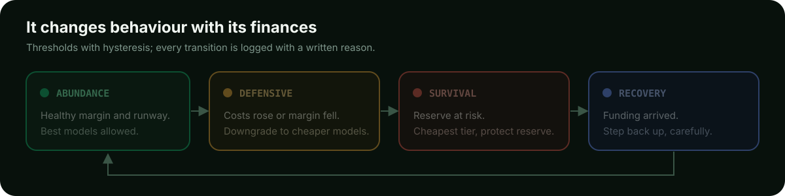
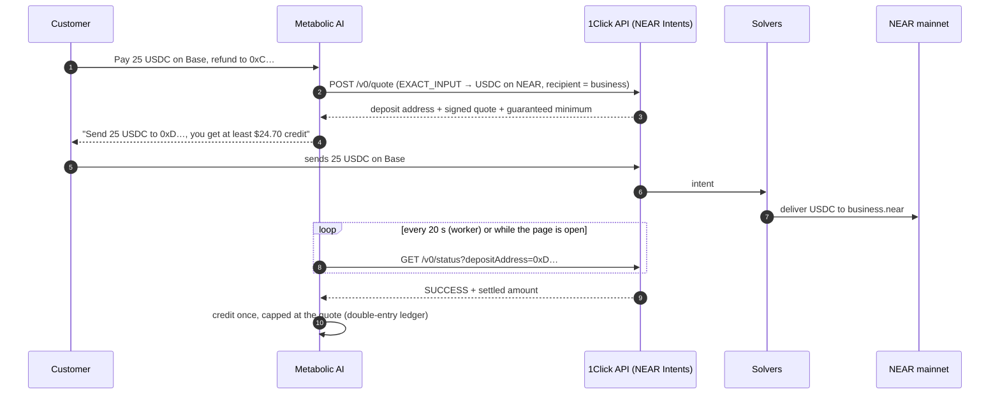
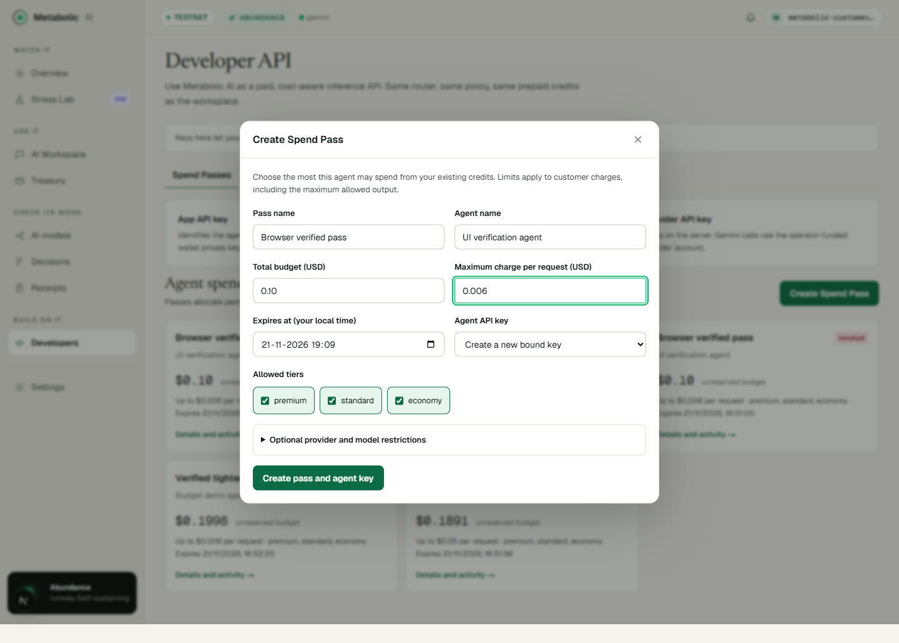
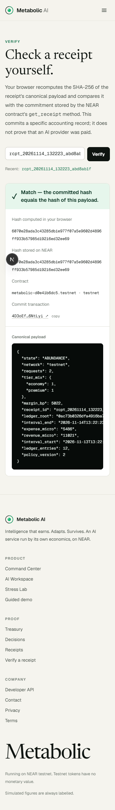
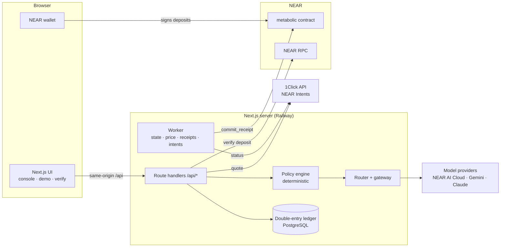

<p align="center">
  
</p>

<p align="center">
  <a href="https://metabolic-ai-five.vercel.app"><b>Live demo</b></a> ·
  <a href="https://metabolic-ai-five.vercel.app/demo">90-second tour</a> ·
  <a href="https://metabolic-ai-five.vercel.app/verify">Verify a receipt</a> ·
  <a href="docs/README.md">Docs</a>
</p>

<p align="center">
  
  
  
  
  
</p>

# Metabolic AI

**An AI service that runs itself as a business.** It earns from every request, pays for its own models from a treasury, switches to cheaper models when money gets tight, and commits a hash of its books to NEAR so anyone can check them.

> **In one sentence:** every AI product has a cost and a price on each answer, and usually a human watches the gap. Metabolic AI watches it itself.

## The idea in 60 seconds

Think of it as a tiny company with no staff:

| A normal AI app | Metabolic AI |
|---|---|
| A person sets prices and picks models | Every request is **priced before it runs**; a policy engine picks the best model the business can **afford right now** |
| Costs spike, someone notices days later | Costs spike, it **downgrades on its next decision** and writes down why |
| Money runs low, the service just breaks | It enters **Survival**, protects its reserve, and **recovers** when funded |
| "Trust our dashboard" | A SHA-256 hash of the books is **committed on NEAR**; recompute it yourself at `/verify` |
| Give an agent an API key and hope | Give an agent a **Spend Pass**: budget, per-request cap, allowed tiers, expiry |

<p align="center"></p>

<p align="center"></p>

## What NEAR does here

Nothing here is "powered by NEAR" in name only. Each piece below is something you can check.

| NEAR piece | What it does in Metabolic AI | Where |
|---|---|---|
| **Wallet sign-in (NEP-413)** | You log in by signing a message with MyNearWallet or Meteor. No password, no email. | [`server/services/auth.ts`](frontend/server/services/auth.ts) |
| **Deposits over RPC** | Credit is booked only after the server reads your transaction at *final* finality, checks payer, receiver, amount and memo, and credits it exactly once. | [`server/services/treasury.ts`](frontend/server/services/treasury.ts) |
| **Our contract** | Rust `near-sdk` contract `metabolic-d0e41b6dc5.testnet`: deposits, receipt commitments, signer list, pause, capped withdraw. | [`contracts/metabolic`](contracts/metabolic/README.md) |
| **Scoped function-call key** | The server can call **one method** (`commit_receipt`) on **one contract** with a capped allowance. It never holds a full-access key. | [`server/services/receipts.ts`](frontend/server/services/receipts.ts) |
| **Verifiable receipts** | `/verify` recomputes a receipt's hash from the stored books and compares it with `get_receipt` on chain. | [`app/verify`](frontend/app/verify) |
| **NEAR AI Cloud** | One of the inference providers (open models through its OpenAI-compatible API). | [`config/models.json`](frontend/config/models.json) |
| **NEAR Intents** | Pay with 200+ tokens on 30+ chains. Solvers swap and deliver **USDC on NEAR** to the business; credit is booked once on settlement. Mainnet. | [`server/services/intents.ts`](frontend/server/services/intents.ts) · [doc 16](docs/16-NEAR-INTENTS.md) |

## Pay with any token (NEAR Intents)

A customer holding USDC on Base, ETH, BTC or SOL does not need NEAR first. They pick a token, get a one-off deposit address, send, and the business receives USDC on NEAR.



Safety rules, all tested: credit is booked **once** even under concurrent checks; never **more than quoted** and never **more than settled**; a status for a different recipient or asset is **rejected**; refunds and failures **credit nothing**. NEAR Intents has no testnet, so this path is **mainnet only** and off until the operator sets `INTENTS_RECIPIENT_ACCOUNT_ID`. Details: [docs/16-NEAR-INTENTS.md](docs/16-NEAR-INTENTS.md).

## Try it (do X, see Y)

**Fastest: open the live demo** at https://metabolic-ai-five.vercel.app (NEAR testnet).

Locally: `cd frontend && cp .env.example .env.local && pnpm install && pnpm dev`, then open http://localhost:3000. Steps 1 and 2 need no wallet, no database setup and no provider key. Step 3 needs only `curl`.

1. **Open `/demo`.** Six chapters autoplay, 15 seconds each. Chapters 3 to 5 (costs spike, money runs out, recovery) are **SIMULATED** and labelled so; the 3D organism and state chip change with each.
2. **Open `/console/stress-lab` and click "Costs rise", then "Funds run low", then "Add funding".** Watch the state move Abundance → Defensive or Survival → Recovery, with the model choice, margin and a written reason for each decision. This runs the real policy engine on an isolated simulated economy and makes no provider calls.
3. **Check a real on-chain receipt without installing anything:**

   ```bash
   curl -sS https://rpc.testnet.near.org -H 'content-type: application/json' -d '{"jsonrpc":"2.0","id":1,"method":"query","params":{"request_type":"call_function","finality":"final","account_id":"metabolic-d0e41b6dc5.testnet","method_name":"get_receipt","args_base64":"eyJpZCI6InJjcHRfMjAyNjExMTRfMTMyMjIzX2FiZDhhYjFmIn0="}}'
   ```

   The `result` byte array decodes to JSON with `hash_hex` `6070e28ada3c43285db1e977f07a5e9602d4896ff933b57985d19216ed32ee69`: the hash the business committed for receipt `rcpt_20261114_132223_abd8ab1f`. Transactions and explorer links: [docs/10-DEPLOYMENT-VERIFICATION.md](docs/10-DEPLOYMENT-VERIFICATION.md); recorded evidence: [`artifacts/testnet-verification/`](artifacts/testnet-verification/).
4. **Run a real paid request.** Needs a provider key in `.env.local` (`GEMINI_API_KEY`, `NEARAI_API_KEY`, `ANTHROPIC_API_KEY`, or another listed in `.env.example`) and a testnet wallet. Follow "Bring it to life on testnet" below, then ask something in `/console/workspace`. You see the model that answered, what it cost the business, what you were charged and why that model was picked; cost is marked **est.** whenever the provider reported no token usage.
5. **Call it as an agent.** `/console/connect` has copy-paste setup for Claude Code, Codex, Gemini CLI, OpenCode, Cursor, Antigravity, Windsurf, VS Code, Claude Desktop and Cline. Underneath: an OpenAI-compatible API (`GET /api/v1/models`, `POST /api/v1/chat/completions`, models `metabolic-auto`, `metabolic-premium`, `metabolic-standard`, `metabolic-economy`) and an MCP server at `/api/mcp`. Both take an API key from `/console/developers`, optionally bound to a Spend Pass.
6. **Pay with any token.** On `/console/treasury`, the *Pay with any token · NEAR Intents* card lists the supported tokens. With `INTENTS_RECIPIENT_ACCOUNT_ID` set, it returns a real deposit address. **This is mainnet and moves real funds**; use a small amount.

<table>
  <tr>
    <td width="62%"><br><sub>Spend Pass: a bounded budget for an agent</sub></td>
    <td width="38%"><br><sub>A receipt recomputed and matched on chain</sub></td>
  </tr>
</table>

## How it is built



The UI is hosted on Vercel and proxies `/api/*` to the Railway server, so the browser only ever talks to one origin ([doc 15](docs/15-VERCEL-FRONTEND.md)).

```
frontend/            Next.js 16 app: UI + backend (route handlers) + in-process worker
  app/               routes: landing, console/*, demo, verify, login, api/*
  server/            domain: policy engine, router, billing, ledger, treasury, intents, receipts, simulation
  components/        UI (m/), 3D organism (organism/)
  config/models.json model catalog + prices
  tests/             unit + integration (vitest), live provider smoke tests
contracts/metabolic/ Rust NEAR contract: deposits + economic receipt commitments
artifacts/           recorded testnet verification evidence (JSON + screenshots, no secrets)
docs/                product, architecture, policy, design, runbook, deployment, NEAR Intents
legacy-algebra/      pre-hackathon Algebra UI, moved aside as the baseline (not built)
```

## Quick start

```bash
cd frontend
cp .env.example .env.local        # set at least one of GEMINI_API_KEY / ANTHROPIC_API_KEY / NEARAI_API_KEY
pnpm install
pnpm dev                          # http://localhost:3000
```

No database setup is needed: without `DATABASE_URL` the app uses an embedded PostgreSQL (PGlite) in `frontend/.data/` and migrates it on first request. Background jobs (state evaluation, snapshots, price refresh, provider health, receipts, NEAR Intents settlement) start inside the server.

**Bring it to life on testnet.** A fresh business has no treasury, so it starts in **Survival**; that is correct.

1. Set `OPERATOR_ACCOUNT_IDS=you.testnet` and a deposit target (`NEAR_CONTRACT_ID` after deploying the contract, or `NEAR_TREASURY_ACCOUNT_ID=some-account.testnet`).
2. Sign in at `/login` with that wallet and **Fund the business** on the Treasury page (operator deposits are operating capital).
3. Sign in with any other testnet wallet, deposit a little NEAR for credits, and ask something in the AI Workspace.

**Deploy:** backend on Railway with Supabase PostgreSQL ([doc 11](docs/11-RAILWAY-SUPABASE.md)), UI on Vercel ([doc 15](docs/15-VERCEL-FRONTEND.md)).

## Checks

```bash
cd frontend
pnpm exec tsc --noEmit     # types
pnpm lint                  # ESLint
pnpm test                  # unit + integration tests (in-memory Postgres, mocked provider/RPC/1Click)
pnpm test:live             # real provider/model checks (uses provider quota)
pnpm test:e2e              # end-to-end HTTP checks against the running server
pnpm build                 # production build

cd ../contracts/metabolic
cargo test                 # contract tests
cargo build --target wasm32-unknown-unknown --release
```

## Honest scope

- **Real:** NEP-413 sign-in, testnet deposits verified over RPC, the contract, scoped-key receipt commitments and on-chain verification, live inference with provider-reported usage, Spend Passes, the double-entry ledger, the policy engine.
- **Simulated, and labelled so:** the Stress Lab and chapters 3 to 5 of `/demo`. They run the real policy engine on a separate scenario scope that never touches the real books.
- **Mainnet, not yet exercised with real funds:** the NEAR Intents payment path. It is tested against a mocked 1Click API and the request shape was checked against the live API with `dry: true` quotes.
- **Not implemented:** Chain Signatures, a mainnet deployment of the contract, and automatic on-chain payment of AI providers (provider keys are operator-funded; provider cost is recorded from reported usage). Spend Passes are enforced by the server, not by a contract. The app does not check NEAR AI Cloud TEE attestation.

## Hackathon disclosures

### Submission snapshot and later work

The NEAR HACKATHON submission is the git tag [`hackathon-submission`](https://github.com/anshitraj/metabolic-ai/tree/hackathon-submission) (commit `cbef802`), pushed before development ended at 2026-11-14 23:59 UTC. **Everything after that tag was built after the deadline** and is not part of the judged submission, including:

- the NEAR Intents pay-with-any-token flow (`server/near/intents.ts`, `server/services/intents.ts`, `app/api/intents/*`, `components/m/intents-pay.tsx`, migration `0005`, doc 16);
- this README rewrite and the animated diagrams in `docs/assets/`.

Compare: [`hackathon-submission...main`](https://github.com/anshitraj/metabolic-ai/compare/hackathon-submission...main).

### Baseline: Algebra (pre-hackathon work)

Before NEAR HACKATHON this folder held **Algebra**, an earlier product by the same author: a Next.js console for AI agents with USDC vaults on Solana and EVM chains, an emailed-code login backed by a separate REST backend, and Spend Pass rules. It had **no NEAR code, no database and no tests** ([docs/02-AUDIT-AND-MIGRATION.md](docs/02-AUDIT-AND-MIGRATION.md), section 1). Metabolic AI is built on top of that checkout.

- **Git history.** The Algebra history is not in this repository. Commit `56a1c61` (2026-11-14) therefore contains baseline and new work together, so there is no `pre-hackathon` tag that isolates the diff.
- **Where the baseline is.** The Algebra UI was moved aside under [`legacy-algebra/`](legacy-algebra/) (178 files: `app/`, `components/`, `lib/`). It is not built or served.
- **What changed, measured by file content.** No file in `frontend/` is byte-identical to a file in `legacy-algebra/`. Six routes share a path with an Algebra route and were rewritten: `app/console/page.tsx`, `app/console/layout.tsx`, `app/console/connect/page.tsx`, `app/console/settings/page.tsx`, `app/demo/page.tsx`, `app/verify/page.tsx`. Eight Algebra files have an obvious successor under a new name (console shell, UI primitives, landing, provider-mark, money helpers, session helper, provider types, model catalog); line-by-line similarity between each pair is 4% to 19%, so they were effectively rewritten. [docs/02-AUDIT-AND-MIGRATION.md](docs/02-AUDIT-AND-MIGRATION.md) section 3 is the migration plan that says which Algebra parts were to be reused, replaced or removed.
- **What is new.** Everything NEAR: the contract, NEP-413 sign-in, deposit verification, receipts and verification, the NEAR AI provider. Spend Passes were reimplemented on NEAR credits with server-enforced budgets (Algebra had a different Spend Pass rules module). Also the policy engine, router, double-entry ledger, simulation, the 3D organism, the OpenAI-compatible API, the MCP server and the Connect page.

### Libraries

- App: Next.js 16, React 19, TypeScript, Tailwind CSS 4, Drizzle ORM, PostgreSQL or embedded PGlite, zod, zustand, motion.
- 3D and graphics: three, @react-three/fiber, @react-three/drei, @react-three/postprocessing, konva / react-konva, @lottiefiles/dotlottie-wc, Remotion (editable social-video exports, see [docs/13-MOTION-AND-SOCIAL-VIDEO.md](docs/13-MOTION-AND-SOCIAL-VIDEO.md)).
- NEAR and crypto: @near-js/accounts, crypto, providers, signers and transactions; @near-wallet-selector/core, modal-ui, my-near-wallet and meteor-wallet; @noble/curves and @noble/hashes; @scure/base, bip32 and bip39. Contract: Rust `near-sdk` 5.6. NEAR Intents through its public 1Click REST API (no SDK dependency).
- Providers: @anthropic-ai/sdk, @google/genai, openai (also used for the OpenAI-compatible DeepSeek, Llama and NEAR AI endpoints).
- Dev: vitest, Playwright, ESLint, drizzle-kit, tsx.

Exact versions are in [`frontend/package.json`](frontend/package.json), [`frontend/pnpm-lock.yaml`](frontend/pnpm-lock.yaml) and [`contracts/metabolic/Cargo.toml`](contracts/metabolic/Cargo.toml). Provider logos in `frontend/public/connectors/` belong to their owners and are used only to identify the tools they name.

### AI-generated code

Most of the code, tests and documents in this repository were written by AI coding agents, Claude Code and OpenAI Codex, working from requirements and direction given by the project owner. The agents also ran the checks above.

### Verification status

- Run 2026-11-15 (after the deadline): `pnpm test --no-file-parallelism` 102 passed (12 files), including `tests/integration/intents.test.ts` 6 passed (exactly-once credit, quote cap, refunds, ownership, mismatched status). A live `dry: true` 1Click quote (5 USDC on Base → USDC on NEAR) confirmed the request and response shape.
- Run 2026-11-15: `pnpm test` 93 passed (11 files). `pnpm test:live` 5 passed against the real Gemini and NEAR AI APIs, including streamed answers with provider-reported token usage.
- Recorded 2026-11-14 in [docs/10-DEPLOYMENT-VERIFICATION.md](docs/10-DEPLOYMENT-VERIFICATION.md): testnet deployment, two real deposits, live requests with pass-bound routing, revocation, and a finalized on-chain receipt that matched the recomputed hash.
- Public deployment (2026-11-15): UI on Vercel, backend on Railway with Supabase PostgreSQL; `/api/health` reports the database ready on both origins.
- **Not exercised:** an interactive MyNearWallet or Meteor signing session with a personal wallet on the public URL, a real-funds NEAR Intents swap, and anything else on mainnet.

## Read next

- [docs/README.md](docs/README.md): the design and architecture documents, in reading order
- [docs/16-NEAR-INTENTS.md](docs/16-NEAR-INTENTS.md): pay with any token, settlement rules and configuration
- [docs/09-SPEND-PASSES.md](docs/09-SPEND-PASSES.md): enforced per-agent budgets
- [docs/10-DEPLOYMENT-VERIFICATION.md](docs/10-DEPLOYMENT-VERIFICATION.md): observed testnet transactions and evidence
- [contracts/metabolic/README.md](contracts/metabolic/README.md): contract API and testnet deployment
- [docs/08-RUNBOOK.md](docs/08-RUNBOOK.md): deploy, operate, and run the 90-second demo

License: [MIT](LICENSE).
