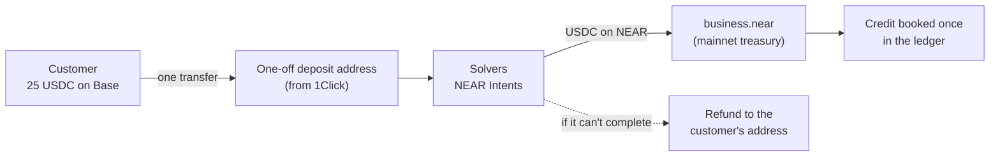

# 16. Pay with any token (NEAR Intents)

> **Built after the hackathon deadline.** Not part of the `hackathon-submission` tag. See the README's "Submission snapshot and later work".

## In plain words

Before this, a customer needed NEAR on testnet to buy credit. Now they can pay with almost anything they already hold (USDC on Base, ETH, BTC, SOL, USDT on Tron and 200+ other tokens on 30+ chains) and the business receives **USDC on NEAR**.

The customer never bridges or swaps anything themselves. They send one transfer to a deposit address, on the chain they already use. NEAR Intents solvers do the rest.

## Why it fits an AI business

An AI business pays its model providers in dollars. Receiving **USDC** removes price risk between the moment a customer pays and the moment the business spends: one USDC unit (6 decimals) is exactly one micro-USD in the ledger, so the credit needs no exchange-rate guess.

## The flow

| Step | Who | What happens |
|---|---|---|
| 1 | Customer | Picks a token and chain, an amount, and a refund address on that chain (`/console/treasury`, *Pay with any token*). |
| 2 | Server | `POST /v0/quote` to the 1Click API: `EXACT_INPUT`, destination `USDC on NEAR`, recipient = the business's mainnet account, `ORIGIN_CHAIN` deposit and refund, 1% slippage, 60-minute deadline. |
| 3 | Server | Checks the quote names the right recipient, asset and amount; stores the **whole signed quote** (needed to resolve disputes); records the **guaranteed minimum** (`minAmountOut`) as the quoted credit. |
| 4 | Customer | Sends the exact amount to the deposit address before the deadline. Optionally pastes the transaction hash, which the server forwards with `POST /v0/deposit/submit` so it is picked up sooner. |
| 5 | Worker + page | `GET /v0/status?depositAddress=…` every 20 seconds (worker) and every 6 seconds while the page is open. |
| 6 | Server | On `SUCCESS`, books the credit in one database transaction: `asset:treasury` debit, `liability:credits` credit, reference `intent_payment`. |

## Settlement rules (all covered by tests)

| Rule | Why |
|---|---|
| Credit is booked **once**, even if the worker and two browser tabs read `SUCCESS` at the same moment. | The row is claimed with `UPDATE … WHERE credited_at IS NULL` inside the ledger transaction. |
| Credit is `min(quoted minimum, actually settled)`. | Never pay out positive slippage; never credit more than arrived. |
| A status whose recipient, destination asset or deposit address differs from the stored quote is **rejected**. | A wrong or tampered response can't credit anyone. |
| `REFUNDED`, `FAILED` and `INCOMPLETE_DEPOSIT` credit **nothing**. | The customer gets their tokens back from NEAR Intents instead. |
| A payment can be read or refreshed only by the account that created it. | Ownership is checked on every route. |
| Amounts outside `$1 – $500` (configurable) are refused before a quote is made. | Keeps a prototype's exposure small. |

Tests: [`frontend/tests/integration/intents.test.ts`](../frontend/tests/integration/intents.test.ts). The 1Click API is mocked there: NEAR Intents has no testnet, so tests never touch mainnet.

## Configuration

| Variable | Required | Meaning |
|---|---|---|
| `INTENTS_RECIPIENT_ACCOUNT_ID` | yes, to switch it on | **Mainnet** NEAR account that receives USDC, e.g. `metabolic.near`. A `.testnet` account is refused. |
| `ONECLICK_JWT` | recommended | Partner JWT from [partners.near-intents.org](https://partners.near-intents.org). Without it 1Click adds a 0.25% fee. |
| `INTENTS_SLIPPAGE_BP` | no (100) | Slippage tolerance in basis points. |
| `INTENTS_MIN_USD_MICRO` / `INTENTS_MAX_USD_MICRO` | no ($1 / $500) | Accepted payment size, in micro-USD. |
| `INTENTS_DEADLINE_MIN` | no (60) | Minutes before an unpaid quote refunds. Raise it for Bitcoin. |
| `ONECLICK_BASE_URL` | no | Defaults to `https://1click.chaindefuser.com`. |

`/api/admin/readiness` reports whether it is on, and whether a JWT is set.

## API

| Route | Auth | Purpose |
|---|---|---|
| `GET /api/intents/tokens` | public | Whether payments are on, the recipient, limits, and supported tokens with USD prices (cached 5 minutes). |
| `POST /api/intents/payments` | signed in | `{ originAsset, amount, refundTo }` → a payment with deposit address, guaranteed credit and deadline. |
| `GET /api/intents/payments` | signed in | Your last 20 payments and your balance. |
| `GET /api/intents/payments/:id` | owner | Refresh from 1Click; credits on first `SUCCESS`. |
| `POST /api/intents/payments/:id/deposit-tx` | owner | `{ txHash }` → forwards it to 1Click to speed up detection. |

Code: [`server/near/intents.ts`](../frontend/server/near/intents.ts) (1Click client and money helpers), [`server/services/intents.ts`](../frontend/server/services/intents.ts) (quotes, settlement, worker job), [`components/m/intents-pay.tsx`](../frontend/components/m/intents-pay.tsx) (UI), migration [`0005_near_intents_payments.sql`](../frontend/server/db/migrations/0005_near_intents_payments.sql).

## Limits, stated plainly

- **Mainnet and real funds.** There is no NEAR Intents testnet. The rest of this app runs on NEAR testnet, so this is the one path that touches mainnet money.
- **Not yet exercised with real funds.** The request and response shapes were checked against the live API with `dry: true` quotes (no deposit address, nothing moves). A real swap has not been run.
- **Credits only.** Operators fund the business through the NEAR deposit flow; Intents payments always become customer credit.
- **The business does not custody the swap.** 1Click and solvers hold nothing on the business's behalf; funds move to a quote-specific deposit address and settle on chain, and refunds go back to the customer's own address.
- **No quote-signature verification yet.** The signed quote is stored for disputes but its `ed25519` signature is not checked against 1Click's key.

References: [1Click API](https://docs.near-intents.org/integration/distribution-channels/1click-api/about-1click-api), [OpenAPI](https://1click.chaindefuser.com/docs/v0/openapi.yaml), [Fees](https://docs.near-intents.org/resources/fees), [Explorer](https://explorer.near-intents.org/).
